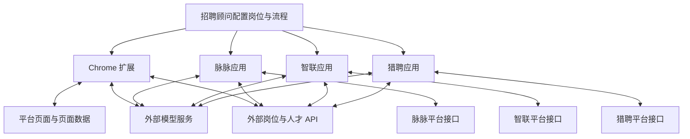

# TalentMatch · AI Recruitment Workflows

多平台 AI 招聘工作流与自动化工具集。将一个 Chrome 扩展和三个 Python 应用整理到同一仓库，以统一展示业务链路、平台适配和工程实现。

An open-source collection of recruitment workflows: a Chrome extension and three Python applications for candidate screening, conversation context and talent synchronization. External model and talent services are not included. Offline tests can run without production accounts.

[](LICENSE)

**业务主线：岗位需求 → 候选人搜索 → AI 筛选 → 沟通跟进 → 意向识别 → 人才库同步。**

> 本仓库是移除内部服务标识后的开源源码快照。各模块独立运行；外部业务服务地址默认使用不可用的示例域名，模型及调用用户 ID 使用占位符。连接真实业务前需要配置自有兼容服务，详见 [服务配置](docs/SERVICE_CONFIGURATION.md)。

## 模块导航

| 模块 | 目录 | 主要职责 | 技术 |
|---|---|---|---|
| 浏览器扩展 | [apps/extension](apps/extension) | 页面数据处理、策略保存与转换、候选人筛查、批量调度 | Chrome MV3、JavaScript、DOM、Service Worker |
| 脉脉助手 | [apps/maimai](apps/maimai) | 搜索、首次联系、自动回复、二次联系、意向入库 | Python、Flask、Vue 3、Requests、Selenium |
| 智联助手 | [apps/zhilian](apps/zhilian) | 搜索与沟通流程、聊天/简历解析、人才同步 | Python、FastAPI、Vue 3、TypeScript |
| 猎聘助手 | [apps/liepin](apps/liepin) | 预筛与开聊前判断、沟通、简历保存、人才查重 | Python、FastAPI、Vue 3、TypeScript |

扩展还包含 LinkedIn 搜索与筛选上传，以及 BOSS 的部分岗位信息处理；各平台能力并不完全一致。

## 与 AI Agent 开发相关的实现

- **模型工作流：**按预筛、匹配、复核、清洗、摘要、标签和回复等任务调用模型服务，由业务逻辑控制后续动作。
- **业务工具接入：**封装招聘平台和人才服务接口，结合扩展消息通信、页面脚本与浏览器自动化处理平台差异。
- **上下文管理：**结合岗位 JD、历史消息、职位卡片、触达记录和本地缓存确定回复范围。
- **任务执行：**批次标识、任务锁、并发限制、状态持久化、心跳回收、请求超时重试及失败项保留。
- **数据一致性：**岗位维度查重、上传成功台账、高潜与正式人才 ID 分离，以及状态回写。
- **结果处理：**固定格式解析、确定性字段提取、部分规则标签优先、诊断日志及离线回归测试。

这些是已有代码的能力描述，不是特定个人贡献或线上性能承诺。没有在本次整理中新增 RAG、模型训练、LangGraph、自主工具选择或多 Agent 协作。

## 架构概览



外部模型服务、人才服务和对应数据库的服务端代码不包含在本仓库中。三个 Python 应用没有被改造为相互调用的微服务。

## 开始阅读与运行

1. [运行与配置说明](docs/SETUP.md)：每个模块的安装目录、前端构建、后端入口和访问地址。
2. [架构与代码导航](docs/ARCHITECTURE.md)：核心链路、代表性实现和已知边界。
3. [验证记录](docs/VALIDATION.md)：本次真正执行的检查，以及没有验证的部分。
4. [安全与数据说明](SECURITY.md)：账号、个人信息、本地服务及公开发布注意事项。
5. [导入与来源说明](docs/SOURCE_IMPORT.md)：原始快照、保留内容及敏感数据清理范围。
6. [服务配置](docs/SERVICE_CONFIGURATION.md)：开源版配置占位符及本地替换方式。

## 无账号离线验证

```sh
node --test apps/extension/tests/*.test.js
cd apps/liepin
python3 -m unittest discover -s tests -p test_highest_education.py
```

完整应用仍需对应依赖、平台账号及自有外部服务。仓库不包含原业务后端，不能直接作为完整 SaaS 部署。

## 参与贡献

欢迎提交可复现的问题、离线测试和改进。请先阅读 [CONTRIBUTING.md](CONTRIBUTING.md)，报告安全问题请使用 [SECURITY.md](SECURITY.md) 中的私密渠道。

```text
talentmatch-ai-recruitment/
├── apps/
│   ├── extension/    # 解压加载的 Chrome 扩展
│   ├── maimai/       # Flask + Vue 应用
│   ├── zhilian/      # FastAPI + Vue 应用
│   └── liepin/       # FastAPI + Vue 应用
├── docs/            # 统一文档、来源与验证记录
├── .gitignore       # 排除账号、运行产物及本地环境
└── SECURITY.md
```

## 使用边界

- 不随仓库提供 Cookie、浏览器登录状态、真实简历、运行日志或付费服务凭证。
- 请先阅读配置并使用合成数据验证；首次运行不要启动全自动沟通或批量上传。
- 本地服务不应暴露到公网；平台页面、接口和外部模型配置变更可能导致功能失效。
- 原模块文档中的历史描述与规划不代表全部功能已在当前版本完成。
- 项目源码按 [Apache-2.0](LICENSE) 提供；保留原作者注释。第三方库、依赖和平台资料保留各自权利与许可证，见 [THIRD_PARTY_NOTICES.md](THIRD_PARTY_NOTICES.md)。
