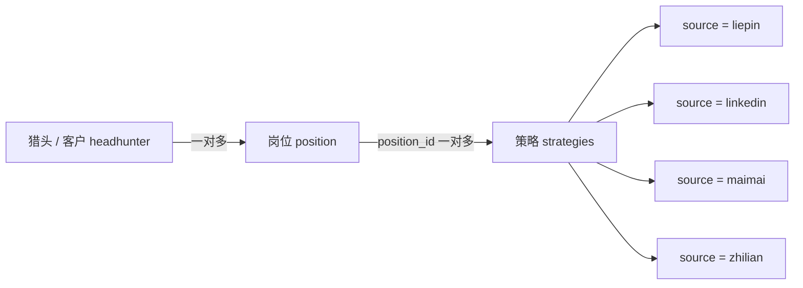
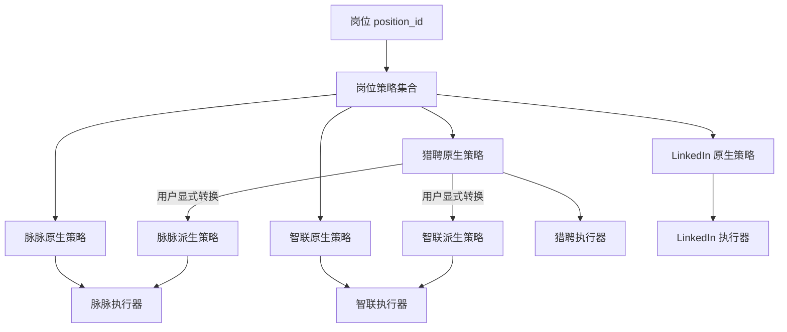

# 招聘平台人员筛选策略关系与跨平台策略处理排查

## 1. 文档目的

本文梳理 TalentMatch 浏览器插件中人员筛选策略（`strategies`）在数据层、平台适配层和执行层之间的关系，重点说明：

1. 猎头、岗位与策略的关联方式；
2. 猎聘、LinkedIn、脉脉、智联和 BOSS 分别如何保存、识别和执行策略；
3. 各平台之间已经存在或可能发生的策略混淆情况；
4. 串台产生的直接原因和底层设计原因；
5. 后续治理时建议采用的平台边界。

本文基于当前仓库代码进行静态排查，不涉及服务端接口实现和线上历史数据质量验证。

---

## 2. 核心结论

当前插件并不是为每个招聘平台维护独立策略库，而是：

> 所有平台的策略都挂在同一个 `position_id` 下，共用同一套策略接口和本地缓存；插件再根据当前页面和 `strategy` 字符串的外观决定展示及执行方式。

策略记录保存时已经包含 `source` 字段，但策略下拉框没有使用 `source` 进行平台隔离，而是使用以下启发式规则：

- 以 `{` 开头：认为是猎聘或脉脉策略；
- 以 `h` 开头：认为是 LinkedIn URL；
- 智联和其他页面：没有专门的过滤规则，可能显示全部策略。

因此目前实际形成了以下关系：

- 猎聘 JSON 被当作跨平台的“半标准中间格式”，可以有意转换给脉脉和智联；
- 脉脉 JSON、智联 JSON 和猎聘 JSON 都以 `{` 开头，无法仅凭字符串开头区分；
- LinkedIn URL 相对独立，但在智联或未知页面仍可能被错误展示；
- BOSS 没有完整的策略执行分支，但仍可能显示和记录其他平台策略；
- `selectedStrategy` 只保存一份原始策略字符串，没有按 `position_id + platform` 隔离。

---

## 3. 数据层关系

### 3.1 实体关系



数据链路为：

1. 插件从 `get_headhunters.php` 获取猎头和客户；
2. 选择猎头后，使用 `headhunter_id` 调用 `get_jds.php` 获取岗位；
3. 选择岗位后，使用 `position_id` 调用 `get_search_strategy.php` 获取该岗位下的全部策略；
4. 各平台保存策略时，都调用 `add_search_strategy.php`；
5. 策略查重统一调用 `duplicate_search_strategy.php`。

关键代码位置：

- 猎头数据加载：`src/core/popup.js:199`
- 岗位加载：`src/core/popup.js:579`
- 岗位策略加载：`src/core/popup.js:669`
- 统一保存策略：`src/core/popup.js:21927`
- 统一策略查重：`src/core/popup.js:21878`

### 3.2 岗位对象与策略对象是两层数据

`headhunterPositions` 只是 `get_jds.php` 返回的岗位数组，随后写入 IndexedDB 的 `jds` 表：

```js
const headhunterPositions = Array.isArray(jdsData.results)
  ? jdsData.results
  : [];

await storeDataInIndexedDB(db, "jds", headhunterPositions);
```

策略并不直接存储在 `headhunterPositions` 变量里。岗位选定以后，插件通过岗位的 `position_id` 另外获取 `strategies`。

因此二者的准确关系是：

```text
headhunterPositions[n].position_id
            │
            └── get_search_strategy.php(position_id)
                         │
                         └── strategies[]
```

所有平台策略共用 `position_id` 命名空间，不存在平台级父表。

---

## 4. 各平台采用策略的方式

### 4.1 总览

| 平台 | 保存的 `source` | `strategy` 主要格式 | 当前展示识别规则 | 执行方式 | 是否支持猎聘策略转换 |
|---|---|---|---|---|---|
| 猎聘 | `liepin` | JSON Session | 以 `{` 开头 | 写入 `sessionStorage.search_resume_session` 并刷新 | 原生格式 |
| LinkedIn | `linkedin` | 搜索 URL | 以 `h` 开头 | 当前标签页跳转到 URL | 否 |
| 脉脉 | `maimai` | JSON，通常包含 `search` 和 `_csrf_token` | 以 `{` 开头 | 替换脉脉原生搜索请求 Payload | 是 |
| 智联 | `zhilian` | JSON，通常包含 `frontExperiment` | 当前没有专门过滤 | 转换为智联 `condition` 后调用智联接口 | 是 |
| BOSS | 当前无完整策略保存来源 | 无固定格式 | 当前没有专门过滤 | 没有策略执行分支 | 否 |

### 4.2 猎聘

猎聘策略是 JSON Session。用户选择策略后，插件将原始 JSON 发送给内容脚本，内容脚本执行：

1. `JSON.parse()`；
2. 写入 `sessionStorage.search_resume_session`；
3. 修改 URL hash；
4. 刷新页面，让猎聘读取 Session。

关键代码：

- 平台分发：`src/core/popup.js:1408`
- 猎聘 Session 注入：`src/core/content.js:383`

猎聘执行端没有验证策略是否真的属于猎聘，也没有验证关键猎聘字段是否存在。因此任何能成功解析的 JSON 都可能被写入猎聘 Session。

### 4.3 LinkedIn

LinkedIn 策略保存的是搜索 URL。用户选择后，插件使用 `new URL()` 做基本校验，然后直接更新当前标签页地址。

关键代码：`src/core/popup.js:1419`

LinkedIn 与其他平台的策略结构差异最大，因此 JSON 策略通常不会进入 LinkedIn 下拉框。但当前识别规则只是 `startsWith("h")`，并没有验证：

- `source === "linkedin"`；
- URL host 是否属于 `linkedin.com`；
- URL path 是否是允许的搜索页面。

### 4.4 脉脉

脉脉存在两种策略执行路径。

#### 脉脉原生策略

如果 JSON 顶层包含 `_csrf_token`，插件认为它是脉脉保存的原生策略：

1. 取出 `_csrf_token`；
2. 保留剩余 Payload；
3. 通过脉脉搜索请求 Hook 替换原生请求。

#### 猎聘转脉脉

如果 JSON 不包含 `_csrf_token`，插件直接认为它是猎聘 Session，并转换以下内容：

- 猎聘行业代码 → 脉脉行业代码；
- 猎聘学历代码 → 脉脉学历字段；
- 城市、职位、学校、关键词 → 脉脉搜索字段；
- 年薪 → 脉脉月薪；
- 活跃时间 → 脉脉支持的天数范围；
- 猎聘 985、211、海外学校字段 → 脉脉学校标签。

关键代码：`src/core/popup.js:1428`

这一跨平台转换是有意设计，但其入口条件过宽：

> “没有 `_csrf_token`”并不能证明该 JSON 是猎聘策略。

智联 JSON、旧版脉脉 JSON或其他 JSON 都可能误入该转换分支。

### 4.5 智联

智联执行端先 `JSON.parse()`，然后区分两种情况：

#### 智联原生策略

如果策略包含 `frontExperiment`，插件认为它来自智联，并基于智联字段构建搜索 `condition`。

#### 猎聘转智联

如果不包含 `frontExperiment`，插件认为它来自猎聘，并把猎聘字段映射到智联字段。

关键代码：`src/core/content.js:1118`

与脉脉类似，智联也把一个弱特征当成平台身份：

> “没有 `frontExperiment`”并不能证明该 JSON 是猎聘策略。

因此脉脉策略也可能被当成猎聘策略转换。

### 4.6 BOSS

当前 `processStrategySelection()` 没有 BOSS 分支。

在 BOSS 页面选择策略时：

1. `selectedStrategy` 仍会写入 localStorage；
2. 平台执行分发找不到 BOSS 分支；
3. 页面不会真正采用策略；
4. 用户可能误以为已经完成筛选条件注入。

BOSS 当前主要支持职位、JD 和候选人处理功能，不属于完整的 strategies 执行体系。

---

## 5. 策略跨平台处理矩阵

以下矩阵描述“在当前平台选择某来源策略”时的实际结果。

| 当前平台 ↓ / 策略来源 → | 猎聘策略 | LinkedIn 策略 | 脉脉策略 | 智联策略 |
|---|---|---|---|---|
| 猎聘 | 正常直接注入 | 通常不展示 | **会展示并直接写入猎聘 Session，结构错误** | **会展示并直接写入猎聘 Session，结构错误** |
| LinkedIn | 通常不展示 | 正常跳转 | 通常不展示 | 通常不展示 |
| 脉脉 | 有意转换后执行 | 通常不展示 | 正常执行 | **会被误认为猎聘策略并错误转换** |
| 智联 | 有意转换后执行 | **会展示，随后 JSON 解析失败** | **会被误认为猎聘策略并错误转换** | 正常执行 |
| BOSS | 会显示但不执行 | 会显示但不执行 | 会显示但不执行 | 会显示但不执行 |

说明：

- “通常不展示”是由字符串开头规则造成的结果，并不是严格的平台隔离；
- 历史脏数据、非标准 URL 或前后空格仍可能改变判断结果；
- 表中的“正常”只表示走入预期代码分支，不代表策略字段一定满足平台最新接口要求。

---

## 6. 最重要的处理异常情况

### 6.1 P0：猎聘、脉脉、智联 JSON 策略被放进同一候选集合

#### 表现

猎聘和脉脉页面都使用以下条件筛选策略：

```js
item.strategy.trim().startsWith("{")
```

因此以下策略都会通过：

- 猎聘 JSON；
- 脉脉 JSON；
- 智联 JSON；
- 任意其他 JSON。

关键代码：

- 远端数据加载后的过滤：`src/core/popup.js:718`
- 本地缓存恢复后的过滤：`src/core/popup.js:36137`

#### 原因

代码使用“数据格式”代替“平台身份”：

```text
JSON ≠ 猎聘
JSON ≠ 脉脉
```

三个平台的策略都是 JSON，但具有完全不同的数据协议。

#### 影响

- 用户能在猎聘页面选择脉脉或智联策略；
- 用户能在脉脉页面选择智联策略；
- 下拉框名称如果没有明确平台前缀，用户无法肉眼判断来源；
- `top_ranked` 策略可能进一步提高错误策略被选择的概率。

### 6.2 P0：保存时写入 `source`，读取时却忽略 `source`

#### 表现

保存策略时已经明确写入平台来源：

```js
strategyFormData.append("source", "liepin");
strategyFormData.append("source", "linkedin");
strategyFormData.append("source", "maimai");
strategyFormData.append("source", "zhilian");
```

统一保存流程也会根据当前 URL 写入 `apiSourceParam`。

但是加载策略时没有使用：

```js
item.source === currentPlatform
```

#### 原因

策略保存模型已经平台化，但展示和执行模型仍停留在早期的格式猜测逻辑，两部分演进不同步。

#### 影响

- 服务端已有的可靠平台字段没有发挥作用；
- 平台隔离完全依赖策略正文；
- 旧策略格式变化或平台升级会直接破坏识别规则。

### 6.3 P0：脉脉把所有“不含 `_csrf_token` 的 JSON”当成猎聘

#### 表现

脉脉的判定逻辑只有：

```text
存在 _csrf_token     → 脉脉原生策略
不存在 _csrf_token   → 猎聘策略
```

#### 原因

该逻辑隐含了错误前提：

```text
JSON 策略只可能来自脉脉或猎聘
```

实际上统一策略集合中还包含智联 JSON。

#### 影响

智联字段无法正确映射为猎聘字段，转换得到的脉脉 Payload 可能出现：

- 关键词为空；
- 公司、职位、城市为空；
- 学历和工作年限失效；
- 搜索被执行但条件过宽；
- 用户误认为应用的是原策略。

“执行成功但筛选条件失真”比直接报错更危险，因为问题不容易被发现。

### 6.4 P0：智联没有下拉框过滤，并把非智联 JSON 当成猎聘

#### 表现

策略加载逻辑没有 `zhaopin` 分支。智联页面会进入默认分支并展示全部策略。

随后：

- LinkedIn URL 会在 `JSON.parse()` 阶段报错；
- 脉脉 JSON 不含 `frontExperiment` 时，会被当成猎聘策略；
- 其他 JSON 也可能进入猎聘转智联映射。

#### 原因

智联的“展示识别”和“执行识别”均缺少明确的平台白名单：

- 展示端没有 `source` 过滤；
- 执行端只检查 `frontExperiment`。

#### 影响

- 明确错误：选择 LinkedIn URL 后无法解析；
- 隐性错误：选择脉脉 JSON 后生成不完整智联条件；
- 用户看到的策略列表与智联实际可执行策略不一致。

### 6.5 P1：BOSS 显示策略但没有执行能力

#### 表现

在非猎聘、LinkedIn、脉脉页面，策略加载默认显示全部记录。但执行分发只包含：

- 猎聘；
- LinkedIn；
- 脉脉；
- 智联。

没有 BOSS 分支。

#### 原因

策略下拉框是全局通用 UI，但平台能力没有同步约束 UI 可见性。

#### 影响

- 用户在 BOSS 页面可以选择策略；
- localStorage 会记录选择；
- 页面没有任何筛选变化；
- 操作结果缺少明确失败提示。

### 6.6 P1：`selectedStrategy` 没有按岗位和平台组成复合 Key

#### 表现

当前只保存：

```js
localStorage.setItem("selectedStrategy", selectedOption);
```

虽然切换岗位时会清理，但同一岗位在不同平台之间切换时，仍使用同一个 Key。

#### 原因

状态模型只考虑了“当前策略”，没有表达：

```text
当前岗位 + 当前平台 + 当前策略
```

#### 影响

- 同一岗位跨平台切换时，策略状态可能被复用或误清除；
- 由于猎聘、脉脉、智联策略都可能通过 JSON 过滤，错误策略可能继续被认为有效；
- 无法分别恢复同一岗位在不同平台最后一次选择的策略。

### 6.7 P1：策略查重没有平台维度

#### 表现

查重只使用 `position_id + strategy`，不使用 `source`。

#### 原因

数据模型把策略正文视为岗位级唯一内容，没有明确平台级唯一性定义。

#### 影响

- 内容完全相同但平台来源不同的策略可能跨平台判重；
- 猎聘原始策略与其转换后的脉脉/智联策略，因为正文不同，又会被视为不同策略；
- 无法区分“同一策略的跨平台派生版本”和“无关的另一条策略”。

---

## 7. 跨平台策略处理失效的底层原因总结

### 7.1 平台类型与数据格式混为一谈

当前代码主要通过 `{` 和 `h` 判断平台，但这只能判断“JSON 或疑似 URL”，不能判断真实来源。

### 7.2 数据层共享，执行层缺少类型约束

同一岗位下共享策略集合本身没有问题，但进入平台执行器前必须完成严格的平台分类和 Schema 校验。当前缺少这一层。

### 7.3 跨平台转换是隐式触发

猎聘转脉脉、猎聘转智联属于有效业务能力，但目前通过“不是本平台格式，那就当作猎聘”的方式自动触发，缺少：

- 明确的源平台判断；
- 用户可见的“转换”动作；
- 转换结果预览；
- 必填字段校验；
- 字段丢失提示。

### 7.4 UI 能力与平台能力不一致

策略下拉框在不支持策略的平台仍可见、可选，但执行端没有对应处理。

### 7.5 历史兼容逻辑与新 `source` 字段未统一

`source` 已经进入保存流程，但读取端仍使用旧的正文猜测规则，形成双重标准。

---

## 8. 建议的平台边界

推荐把“平台原生策略”和“跨平台转换”拆成两个明确概念。

### 8.1 下拉框默认只展示当前平台原生策略

```text
猎聘：source === "liepin"
LinkedIn：source === "linkedin"
脉脉：source === "maimai"
智联：source === "zhilian"
BOSS：隐藏或禁用策略下拉框
```

### 8.2 猎聘跨平台转换作为显式能力

脉脉和智联可以额外显示一个独立入口：

```text
从猎聘策略转换
```

而不是把猎聘策略混入本平台原生策略列表。

### 8.3 引入统一策略类型

建议前端将接口记录规范化为：

```js
{
  id,
  positionId,
  sourcePlatform,
  targetPlatform,
  format,
  payload,
  name,
  topRanked,
  createdAt,
  derivedFromStrategyId
}
```

其中：

- `sourcePlatform`：策略最初来自哪个平台；
- `targetPlatform`：该策略实际可在哪个平台执行；
- `format`：`liepin-session`、`linkedin-url`、`maimai-search`、`zhilian-condition`；
- `derivedFromStrategyId`：记录跨平台转换来源。

### 8.4 执行前同时校验 source、format 和 Schema

不能只做以下判断：

```js
startsWith("{")
startsWith("h")
hasOwnProperty("_csrf_token")
hasOwnProperty("frontExperiment")
```

至少应校验：

1. 当前页面平台；
2. 策略 `source`；
3. 策略声明的 `format`；
4. 目标平台关键字段；
5. URL host 白名单；
6. 跨平台转换是否为用户明确选择。

### 8.5 本地选择状态使用复合 Key

建议从：

```text
selectedStrategy
```

调整为类似：

```text
selectedStrategy:{position_id}:{platform}
```

从而分别恢复每个岗位在各平台最后使用的策略。

### 8.6 对历史无 `source` 数据进行兼容

历史策略可能没有 `source`。建议兼容顺序为：

1. 有 `source`：严格按 `source`；
2. 无 `source`：进入一次性的兼容分类器；
3. 分类结果明确时，为记录补写 `source`；
4. 分类不明确时，标记为 `unknown`，不要自动执行；
5. 不再长期依赖字符串首字符作为正式平台判断。

---

## 9. 建议整改优先级

| 优先级 | 整改项 | 目的 |
|---|---|---|
| P0 | 下拉框改为优先按 `source` 过滤 | 立即阻止主要串台 |
| P0 | 为智联增加独立过滤分支 | 阻止 URL 和脉脉 JSON 进入智联执行器 |
| P0 | 脉脉、智联转换前明确校验 `source === "liepin"` | 阻止错误隐式转换 |
| P0 | 各平台执行前增加 Schema 校验 | 防止错误策略被静默执行 |
| P1 | 猎聘跨平台转换改为显式按钮或分组 | 区分原生策略与派生策略 |
| P1 | `selectedStrategy` 改为岗位与平台复合 Key | 阻止跨页面状态污染 |
| P1 | 查重增加平台语义或派生关系 | 明确跨平台策略版本关系 |
| P1 | BOSS 页面隐藏或禁用策略选择 | 避免无效操作 |
| P2 | 迁移历史无 `source` 数据 | 清理长期兼容风险 |

---

## 10. 最终关系定义

当前代码中的 strategies 可以准确描述为：

> `position_id` 是所有平台策略的共同父级；`source` 本应承担平台分类职责；猎聘 JSON 同时被用作脉脉和智联的跨平台转换源；LinkedIn URL 独立执行；脉脉和智联具有各自原生 JSON，但由于读取端忽略 `source`，三个 JSON 平台之间存在明显串台。

目标关系应调整为：



即：

- 数据可以继续按岗位统一管理；
- 展示必须按平台隔离；
- 跨平台转换必须显式；
- 执行必须经过平台和 Schema 双重校验；
- 原生策略与派生策略应保留可追溯关系。
